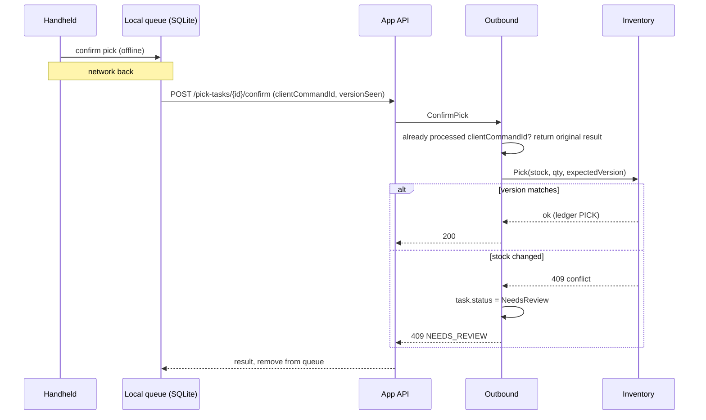

# WMS SaaS: Low-Level Design

| Field | Value |
|---|---|
| Version | 1.0 |
| Date | 2026-11-21 |
| Phase | 3. Solution Architect, step 2 of 3 |
| Source | `05-architecture-hld.md` |
| Accepted on 2026-11-21 | ADR-003 PostgreSQL (Aurora), ADR-005 SNS/SQS + outbox, ADR-014 Blazor WebAssembly |

> **Superseded during implementation (see `decisions.md`):**
> - Section 2.5 code: replaced by TQ-07 (UnitOfWork creates the connection object up front; decorators open it async; `AutoTransactionBehavior.Never`). The real code is in `src/BuildingBlocks/Wms.Infrastructure.Common/Persistence/`.
> - Section 3.1 policy: use `NULLIF(current_setting('app.tenant_id', true), '')::uuid` (TQ-14).
> - Section 13 "EF Core migrations": replaced by SQL-first migrations (TQ-11).
> - Sections 1 and 14 "ArchUnitNET": replaced by `.csproj`-based rules (TQ-13).
> - Section 1 reference rules: `*.Endpoints` may also reference its own `Infrastructure` (TQ-12); `*.Infrastructure` may reference own and other modules' `Contracts`.

---

## 1. Repository and Solution Structure

One Git repository (monorepo). One solution file plus a solution filter per host.

```
wms/
├─ src/
│  ├─ BuildingBlocks/
│  │  ├─ Wms.SharedKernel/                 # Entity, AggregateRoot, ValueObject, Result, Error, StrongId
│  │  ├─ Wms.Application.Abstractions/     # ICommand, IQuery, handlers, dispatcher, ITenantContext, IUserContext, IClock
│  │  ├─ Wms.Infrastructure.Common/        # UnitOfWork, Outbox, Inbox, RLS interceptor, caching, feature flags, config resolver
│  │  └─ Wms.Web.Common/                   # Endpoint filters (flag, permission, scope), ProblemDetails, versioning
│  ├─ Modules/
│  │  ├─ Platform/
│  │  │  ├─ Wms.Platform.Domain/
│  │  │  ├─ Wms.Platform.Application/
│  │  │  ├─ Wms.Platform.Infrastructure/
│  │  │  ├─ Wms.Platform.Contracts/
│  │  │  └─ Wms.Platform.Endpoints/
│  │  ├─ Identity/  Catalog/  Layout/  Inventory/  Inbound/  Outbound/
│  │  ├─ Returns/   Counting/ Traceability/ Integration/ Reporting/
│  │  └─ Notifications/  Devices/
│  ├─ Hosts/
│  │  ├─ Wms.Host.AppApi/                  # /api/app
│  │  ├─ Wms.Host.IntegrationApi/          # /api/v1
│  │  ├─ Wms.Host.Worker/                  # outbox, consumers, jobs, webhooks, connectors
│  │  ├─ Wms.Host.Realtime/                # SignalR hubs
│  │  └─ Wms.Host.Migrator/                # runs SQL migrations, one-off ECS task
│  └─ Clients/
│     ├─ Wms.AppApi.Client/                # DTOs + typed HTTP client shared by Web and Handheld
│     ├─ Wms.Web/                          # Blazor WebAssembly shell
│     ├─ Wms.Web.Modules.<Module>/         # Razor class library per module (pages, components)
│     ├─ Wms.Handheld/                     # .NET MAUI Android app
│     └─ Wms.EdgeAgent/                    # Windows Worker Service
├─ tests/
│  ├─ Wms.<Module>.Domain.Tests/           # xUnit, pure unit tests
│  ├─ Wms.<Module>.Application.Tests/      # handlers with fakes
│  ├─ Wms.IntegrationTests/                # Testcontainers PostgreSQL, real HTTP via WebApplicationFactory
│  ├─ Wms.ArchitectureTests/               # module boundary rules (reads .csproj files)
│  ├─ Wms.TenantIsolationTests/            # EN-06
│  └─ load/                                # k6 scripts (EN-08)
├─ infra/terraform/                        # envs: dev, test, prod-ap-south-1, dr-ap-south-2
├─ docs/                                   # these design docs + decisions.md
├─ Directory.Build.props                   # .NET 10, nullable, warnings as errors, analyzers
└─ Directory.Packages.props                # central package versions
```

**Reference rules (enforced by `Wms.ArchitectureTests`):**

| Project | May reference |
|---|---|
| `*.Domain` | SharedKernel only |
| `*.Application` | own Domain, Application.Abstractions, **other modules' Contracts** |
| `*.Infrastructure` | own Application + Domain, Infrastructure.Common, any module's Contracts |
| `*.Contracts` | SharedKernel only (no Domain types leak out) |
| `*.Endpoints` | own Application, own Contracts, own Infrastructure (composition), Web.Common |
| Hosts | any module's Endpoints/Infrastructure (composition only) |

A module may **never** reference another module's Domain, Application, or Infrastructure.

---

## 2. Building Blocks

### 2.1 IDs
All IDs are UUID v7 (`Guid.CreateVersion7()`, wrapped as `Ids.New()`), time-ordered, good for B-tree inserts. Strongly typed per entity:

```csharp
public readonly record struct StockRecordId(Guid Value)
{
    public static StockRecordId New() => new(Ids.New());
}
```

### 2.2 Result and errors
No exceptions for business rule failures. See `src/BuildingBlocks/Wms.SharedKernel/Result.cs` and `Error.cs`.

Error codes are constants per module (e.g. `InboundErrors.OverReceipt = "INB_OVER_RECEIPT"`). Endpoints map them to HTTP: validation 400, not found 404, rule violation 422, concurrency 409, module disabled 403.

### 2.3 Command and query dispatch (in-house, no MediatR)

```csharp
public interface ICommand<TResult>;
public interface IQuery<TResult>;

public interface ICommandHandler<in TCommand, TResult> where TCommand : ICommand<TResult>
{
    Task<Result<TResult>> Handle(TCommand command, CancellationToken ct);
}

public interface IQueryHandler<in TQuery, TResult> where TQuery : IQuery<TResult>
{
    Task<Result<TResult>> Handle(TQuery query, CancellationToken ct);
}
```

Handlers are resolved directly from DI by endpoints (`ICommandHandler<ReceiveLine, ReceiptLineDto>`). Cross-cutting behaviour (validation, transaction, logging) is applied with **decorators** registered via Scrutor:

```
Endpoint > ValidationDecorator > TransactionDecorator > LoggingDecorator > Handler
```

`TransactionDecorator` applies only to commands. Queries never open a write transaction.

### 2.4 Tenant and user context

```csharp
public interface ITenantContext
{
    Guid TenantId { get; }
    string PlanCode { get; }
    string ConnectionKey { get; }   // "shared-ap-south-1" or dedicated key
}

public interface IUserContext
{
    Guid UserId { get; }
    Guid? DeviceId { get; }
    Guid? WarehouseId { get; }      // current warehouse (handheld login or web selector)
    UserScope Scope { get; }        // warehouses, clients, zones per permission (cached) - arrives with US-009
    bool Has(string permission, Guid? warehouseId = null, Guid? clientId = null);
}
```

### 2.5 Unit of Work: one connection, one transaction, many module DbContexts
All modules share one PostgreSQL database (schema per module). A request-scoped `UnitOfWork` owns a single `NpgsqlConnection` and transaction. Every module `DbContext` is built on that connection, so a receive that touches Inbound and Inventory commits atomically.

Implemented per TQ-07 (see `decisions.md` and `Wms.Infrastructure.Common/Persistence`). **The rule that matters is one connection and one transaction per command.**

### 2.6 Tenant filter in EF Core (layer 2)
`TenantDbContext` applies a global query filter `TenantId == current` to every `ITenantOwned` entity, stamps `TenantId` on insert, and refuses to modify another tenant's rows.

### 2.7 Outbox and inbox
- `messaging.outbox_message (id, tenant_id, type, payload jsonb, occurred_at, published_at null, attempts)`
- Written in the same transaction as the business change, through `IEventPublisher.EnqueueAsync(IntegrationEvent)`.
- Worker `OutboxDispatcher` polls unpublished rows with `FOR UPDATE SKIP LOCKED` (batch 200, every 500 ms), publishes to SNS topic `wms-events-{env}` with message attribute `type`, sets `published_at`. Locally, a PostgreSQL-backed transport is used (TQ-08).
- Each consumer has an SQS queue subscribed with a filter policy on `type`.
- `messaging.inbox_message (consumer, event_id)` primary key prevents double handling.

### 2.8 Endpoint filters (flag, permission, scope)

```csharp
public static class EndpointConventions
{
    public static RouteGroupBuilder ForModule(this RouteGroupBuilder g, string featureFlag) =>
        g.AddEndpointFilter(new FeatureFlagFilter(featureFlag));

    public static RouteHandlerBuilder RequirePermission(this RouteHandlerBuilder b, string permission) =>
        b.AddEndpointFilter(new PermissionFilter(permission));
}

// usage in Wms.Inbound.Endpoints
var g = app.MapGroup("/api/app/inbound").ForModule("module.inbound").RequireAuthorization();
g.MapPost("/asns/{asnId:guid}/receipt-lines", ReceiveLineEndpoint.Handle)
 .RequirePermission("Inbound.Receive");
```

`FeatureFlagFilter` returns 403 `MODULE_DISABLED`. `PermissionFilter` checks `IUserContext.Has(permission, warehouseId)`. Client and zone scope are checked in the handler, because they depend on the loaded data.

### 2.9 Config resolution

```csharp
public interface IConfigResolver
{
    ValueTask<T> Get<T>(string key, ConfigScope scope, CancellationToken ct = default);
}

public sealed record ConfigScope(Guid? WarehouseId = null, Guid? ClientId = null, Guid? SkuId = null);
```

Algorithm: build candidate keys in order SKU, Client, Warehouse, Tenant, Platform; return the first value found. All values for a tenant are loaded into one dictionary per tenant and cached (memory 30 s + Redis, invalidated by pub/sub on change). One resolve is a dictionary lookup, no DB call on hot paths.

**Snapshot rule (FR-CFG-04):** documents that run over time (ASN, pick list, count plan) store the resolved values they depend on in a `rules_snapshot jsonb` column when they start.

### 2.10 Module registration

```csharp
public interface IModule
{
    string Name { get; }
    void Register(IServiceCollection services, IConfiguration config);
    void MapEndpoints(IEndpointRouteBuilder app);     // no-op in Worker
    // RegisterConsumers(IConsumerRegistry registry) arrives with the Worker host
}
```

Each host lists the modules it composes. Adding a module = one class + one line in the host.

---

## 3. Data Model (PostgreSQL)

Conventions: snake_case, schema per module, every tenant-owned table has `tenant_id uuid not null` as the first column of its primary key or a leading index, RLS enabled, `xmin` used as concurrency token.

### 3.1 Row-level security template (layer 3)

```sql
ALTER TABLE inventory.stock_record ENABLE ROW LEVEL SECURITY;
ALTER TABLE inventory.stock_record FORCE ROW LEVEL SECURITY;

CREATE POLICY tenant_isolation ON inventory.stock_record
  USING      (tenant_id = NULLIF(current_setting('app.tenant_id', true), '')::uuid)
  WITH CHECK (tenant_id = NULLIF(current_setting('app.tenant_id', true), '')::uuid);
```

If `app.tenant_id` is not set or empty, the expression is NULL and no rows match. The application role `wms_app` has no `BYPASSRLS`. Only `wms_platform_jobs` (used by a few Worker jobs such as tenant export) has it, and every use is audited.

### 3.2 Platform

```sql
CREATE TABLE platform.tenant (
  tenant_id      uuid PRIMARY KEY,
  code           varchar(20)  NOT NULL UNIQUE,
  name           varchar(200) NOT NULL,
  subdomain      varchar(63)  NOT NULL UNIQUE,
  plan_code      varchar(30)  NOT NULL,
  status         varchar(20)  NOT NULL,          -- Trial, Active, Suspended, Terminated
  region         varchar(20)  NOT NULL,
  connection_key varchar(50)  NOT NULL,
  time_zone      varchar(50)  NOT NULL,
  currency       char(3)      NOT NULL,
  lpn_prefix     varchar(4)   NOT NULL,
  gs1_prefix     varchar(12),
  logo_s3_key    varchar(300),
  created_at     timestamptz  NOT NULL
);   -- catalog table: no RLS, read only by Platform module

CREATE TABLE platform.warehouse (
  tenant_id    uuid NOT NULL,
  warehouse_id uuid NOT NULL,
  code         varchar(6)   NOT NULL,
  name         varchar(200) NOT NULL,
  gstin        varchar(15),
  time_zone    varchar(50)  NOT NULL,
  status       varchar(20)  NOT NULL,
  go_live_mode boolean      NOT NULL DEFAULT true,
  PRIMARY KEY (tenant_id, warehouse_id),
  UNIQUE (tenant_id, code)
);

CREATE TABLE platform.client (
  tenant_id uuid NOT NULL, client_id uuid NOT NULL,
  code varchar(20) NOT NULL, name varchar(200) NOT NULL, gstin varchar(15),
  status varchar(20) NOT NULL,
  PRIMARY KEY (tenant_id, client_id), UNIQUE (tenant_id, code)
);

CREATE TABLE platform.config_value (
  tenant_id    uuid NOT NULL,
  key          varchar(100) NOT NULL,
  level        varchar(10)  NOT NULL,   -- T, W, C, S
  scope_id     uuid,                    -- null for T
  value        jsonb        NOT NULL,
  modified_at  timestamptz  NOT NULL,
  modified_by  uuid         NOT NULL,
  UNIQUE NULLS NOT DISTINCT (tenant_id, key, level, scope_id)
);

CREATE TABLE platform.feature_setting (
  tenant_id uuid NOT NULL, flag_key varchar(60) NOT NULL,
  client_id uuid, enabled boolean NOT NULL,
  UNIQUE NULLS NOT DISTINCT (tenant_id, flag_key, client_id)
);

CREATE TABLE platform.document_sequence (
  tenant_id uuid NOT NULL, warehouse_id uuid NOT NULL,
  doc_type varchar(20) NOT NULL, period varchar(6) NOT NULL,
  next_value bigint NOT NULL,
  PRIMARY KEY (tenant_id, warehouse_id, doc_type, period)
);
```

### 3.3 Layout

```sql
CREATE TABLE layout.location (
  tenant_id       uuid NOT NULL,
  location_id     uuid NOT NULL,
  warehouse_id    uuid NOT NULL,
  code            varchar(20) NOT NULL,
  zone            varchar(10) NOT NULL,
  aisle varchar(5), bay varchar(5), level varchar(5), bin varchar(5),
  type            varchar(20) NOT NULL,
  max_weight_kg   numeric(10,2), max_volume_m3 numeric(10,3), max_pallets smallint,
  allow_mixed_sku    boolean NOT NULL DEFAULT false,
  allow_mixed_batch  boolean NOT NULL DEFAULT false,
  allow_mixed_client boolean NOT NULL DEFAULT false,
  allowed_statuses   varchar(20)[] NOT NULL,
  velocity_class  char(1),
  pick_sequence   integer NOT NULL DEFAULT 0,
  status          varchar(20) NOT NULL,      -- Active, Blocked, Counting
  check_digits    char(2) NOT NULL,
  PRIMARY KEY (tenant_id, location_id),
  UNIQUE (tenant_id, warehouse_id, code)
);
CREATE INDEX ix_location_putaway ON layout.location (tenant_id, warehouse_id, zone, status, pick_sequence);
```

### 3.4 Inventory

```sql
CREATE TABLE inventory.lpn (
  tenant_id uuid NOT NULL, lpn_id uuid NOT NULL,
  code varchar(20) NOT NULL, type varchar(10) NOT NULL,      -- Pallet, Carton
  parent_lpn_id uuid, warehouse_id uuid NOT NULL, location_id uuid,
  status varchar(10) NOT NULL,                               -- Open, Closed, Shipped, Consumed
  sscc char(18),
  PRIMARY KEY (tenant_id, lpn_id), UNIQUE (tenant_id, code)
);

CREATE TABLE inventory.stock_record (
  tenant_id     uuid NOT NULL,
  stock_id      uuid NOT NULL,
  warehouse_id  uuid NOT NULL,
  location_id   uuid NOT NULL,
  lpn_id        uuid,
  client_id     uuid NOT NULL,
  sku_id        uuid NOT NULL,
  batch         varchar(40),
  expiry_date   date,
  mfg_date      date,
  serial        varchar(60),
  mrp           numeric(12,2),
  status        varchar(20) NOT NULL,
  on_hand_qty   numeric(18,4) NOT NULL CHECK (on_hand_qty >= 0),
  allocated_qty numeric(18,4) NOT NULL DEFAULT 0 CHECK (allocated_qty >= 0 AND allocated_qty <= on_hand_qty),
  received_at   timestamptz NOT NULL,             -- FIFO key
  PRIMARY KEY (tenant_id, stock_id),
  UNIQUE NULLS NOT DISTINCT (tenant_id, warehouse_id, location_id, lpn_id, client_id, sku_id,
                             batch, expiry_date, mfg_date, serial, status)
);
CREATE INDEX ix_stock_alloc ON inventory.stock_record
  (tenant_id, warehouse_id, client_id, sku_id, status, expiry_date, received_at)
  WHERE on_hand_qty > allocated_qty;
CREATE INDEX ix_stock_location ON inventory.stock_record (tenant_id, location_id);
CREATE INDEX ix_stock_batch    ON inventory.stock_record (tenant_id, client_id, sku_id, batch);
CREATE UNIQUE INDEX ux_serial_in_stock ON inventory.stock_record (tenant_id, client_id, sku_id, serial)
  WHERE serial IS NOT NULL AND on_hand_qty > 0;       -- FR-INV-27

CREATE TABLE inventory.ledger_event (
  tenant_id        uuid NOT NULL,
  occurred_at      timestamptz NOT NULL,
  event_id         uuid NOT NULL,
  event_type       varchar(30) NOT NULL,
  warehouse_id     uuid NOT NULL,
  client_id        uuid NOT NULL,
  sku_id           uuid NOT NULL,
  batch varchar(40), expiry_date date, serial varchar(60),
  from_location_id uuid, to_location_id uuid,
  from_lpn_id uuid, to_lpn_id uuid,
  from_status varchar(20), to_status varchar(20),
  qty              numeric(18,4) NOT NULL,
  reason_code      varchar(30),
  source_doc_type  varchar(20), source_doc_id uuid, source_doc_no varchar(30),
  user_id          uuid NOT NULL, device_id uuid,
  correlation_id   uuid NOT NULL,
  PRIMARY KEY (tenant_id, occurred_at, event_id)
) PARTITION BY RANGE (occurred_at);

CREATE INDEX ix_ledger_batch ON inventory.ledger_event (tenant_id, sku_id, batch, occurred_at);
CREATE INDEX ix_ledger_lpn   ON inventory.ledger_event (tenant_id, from_lpn_id);
CREATE INDEX ix_ledger_lpn2  ON inventory.ledger_event (tenant_id, to_lpn_id);
CREATE INDEX ix_ledger_doc   ON inventory.ledger_event (tenant_id, source_doc_id);

-- Monthly partitions created 3 months ahead by a Worker job:
-- CREATE TABLE inventory.ledger_event_2027_01 PARTITION OF inventory.ledger_event
--   FOR VALUES FROM ('2027-01-01') TO ('2027-02-01');

REVOKE UPDATE, DELETE, TRUNCATE ON inventory.ledger_event FROM wms_app;   -- append-only (FR-INV-12)

CREATE TABLE inventory.adjustment (
  tenant_id uuid NOT NULL, adjustment_id uuid NOT NULL, number varchar(30) NOT NULL,
  warehouse_id uuid NOT NULL, stock_id uuid NOT NULL,
  qty_delta numeric(18,4) NOT NULL, value_delta numeric(14,2),
  reason_code varchar(30) NOT NULL,
  status varchar(20) NOT NULL,            -- Applied, PendingApproval, Approved, Rejected
  requested_by uuid NOT NULL, approved_by uuid,
  CHECK (approved_by IS NULL OR approved_by <> requested_by),   -- FR-IAM-10 at DB level too
  PRIMARY KEY (tenant_id, adjustment_id)
);
```

### 3.5 Inbound (abridged)

```sql
CREATE TABLE inbound.asn (
  tenant_id uuid, asn_id uuid, number varchar(30), warehouse_id uuid, client_id uuid,
  client_ref varchar(60), supplier_name varchar(200), expected_date date,
  status varchar(20), arrived_at timestamptz, dock_location_id uuid,
  rules_snapshot jsonb,                         -- FR-CFG-04
  PRIMARY KEY (tenant_id, asn_id),
  UNIQUE (tenant_id, client_id, client_ref)     -- FR-INB-01
);
CREATE TABLE inbound.asn_line (
  tenant_id uuid, asn_line_id uuid, asn_id uuid, sku_id uuid,
  expected_qty numeric(18,4), received_qty numeric(18,4) DEFAULT 0,
  batch varchar(40), expiry_date date, status varchar(20),
  PRIMARY KEY (tenant_id, asn_line_id)
);
CREATE TABLE inbound.receipt_line (
  tenant_id uuid, receipt_line_id uuid, asn_id uuid, asn_line_id uuid,
  stock_id uuid, lpn_id uuid, qty numeric(18,4), received_by uuid, received_at timestamptz,
  client_command_id uuid UNIQUE,                -- handheld idempotency
  PRIMARY KEY (tenant_id, receipt_line_id)
);
CREATE TABLE inbound.qc_inspection (...);
CREATE TABLE inbound.putaway_rule  (...);       -- ordered rules, match columns + zones text[]
CREATE TABLE inbound.putaway_task  (...);
```

### 3.6 Outbound (abridged)

```sql
CREATE TABLE outbound.sales_order (
  tenant_id uuid, order_id uuid, number varchar(30), warehouse_id uuid, client_id uuid,
  client_ref varchar(60), order_type varchar(5), priority smallint,
  required_ship_date date, cutoff_at timestamptz,
  ship_to jsonb, invoice_no varchar(30), invoice_value numeric(14,2), invoice_date date,
  status varchar(20), hold_reason varchar(30),
  PRIMARY KEY (tenant_id, order_id),
  UNIQUE (tenant_id, client_id, client_ref)
);
CREATE INDEX ix_order_queue ON outbound.sales_order (tenant_id, warehouse_id, status, priority, required_ship_date);

CREATE TABLE outbound.order_line (
  tenant_id uuid, order_line_id uuid, order_id uuid, sku_id uuid,
  qty numeric(18,4), allocated_qty numeric(18,4) DEFAULT 0, picked_qty numeric(18,4) DEFAULT 0,
  shipped_qty numeric(18,4) DEFAULT 0, requested_batch varchar(40), min_shelf_life_pct smallint,
  status varchar(20), PRIMARY KEY (tenant_id, order_line_id)
);

CREATE TABLE outbound.allocation (
  tenant_id uuid, allocation_id uuid, order_line_id uuid, stock_id uuid,
  qty numeric(18,4), uom varchar(10), status varchar(20),   -- Reserved, Picked, Released
  PRIMARY KEY (tenant_id, allocation_id)
);

CREATE TABLE outbound.pick_list (...);
CREATE TABLE outbound.pick_task (
  tenant_id uuid, pick_task_id uuid, pick_list_id uuid, allocation_id uuid,
  location_id uuid, sku_id uuid, batch varchar(40), qty numeric(18,4),
  sequence integer, status varchar(20), assigned_to uuid, version_seen bigint,
  PRIMARY KEY (tenant_id, pick_task_id)
);
CREATE TABLE outbound.carton (...);
CREATE TABLE outbound.shipment (...);
CREATE TABLE outbound.manifest (...);
```

Other module schemas (Returns, Counting, Traceability recall, Integration message log, Reporting summaries, Devices) follow the same rules and are finalized by the Tech Lead in the sprint where they are built.

---

## 4. Inventory Module Contracts

```csharp
namespace Wms.Inventory.Contracts;

public interface IInventoryCommands
{
    Task<Result<StockChange>> Receive(ReceiveStock cmd, CancellationToken ct);
    Task<Result<StockChange>> Move(MoveStock cmd, CancellationToken ct);
    Task<Result<StockChange>> ChangeStatus(ChangeStockStatus cmd, CancellationToken ct);
    Task<Result<IReadOnlyList<Reservation>>> Reserve(IReadOnlyList<ReserveStock> cmds, CancellationToken ct);
    Task<Result<Unit>> Release(IReadOnlyList<Guid> allocationIds, CancellationToken ct);
    Task<Result<StockChange>> Pick(PickStock cmd, CancellationToken ct);
    Task<Result<StockChange>> Ship(ShipStock cmd, CancellationToken ct);
    Task<Result<StockChange>> Adjust(AdjustStock cmd, CancellationToken ct);
    Task<Result<int>> BlockBatch(BlockBatch cmd, CancellationToken ct);
}

public interface IInventoryQueries
{
    Task<IReadOnlyList<EligibleStock>> GetEligibleStock(EligibleStockQuery q, CancellationToken ct);
    Task<IReadOnlyList<StockView>> GetByLocation(Guid locationId, CancellationToken ct);
    Task<IReadOnlyList<StockView>> GetByLpn(Guid lpnId, CancellationToken ct);
}

public sealed record SourceDocument(string Type, Guid Id, string Number);

public sealed record ReceiveStock(
    Guid WarehouseId, Guid LocationId, Guid? LpnId, Guid ClientId, Guid SkuId,
    string? Batch, DateOnly? Expiry, DateOnly? MfgDate, string? Serial, decimal? Mrp,
    string Status, decimal QtyBase, SourceDocument Source, Guid CorrelationId);
```

Inventory's handlers do three things in the caller's transaction: validate location rules through `ILayoutQueries` (FR-LOC-07), upsert the stock record, insert the ledger event. They also enqueue a `StockChanged` integration event to the outbox.

---

## 5. Allocation Algorithm (FR-OUT-10 to 16)

```csharp
public sealed class AllocationService
{
    public AllocationPlan Plan(
        IReadOnlyList<OrderLineToAllocate> lines,        // sorted: priority, ship date, created
        IReadOnlyList<EligibleStock> stock,              // one set-based query per client + warehouse
        AllocationRules rules)                            // resolved config snapshot
    {
        var available = stock.ToDictionary(s => s.StockId, s => s.AvailableQty);
        var plan = new AllocationPlan();

        foreach (var line in lines)
        {
            var candidates = stock
                .Where(s => s.SkuId == line.SkuId
                         && (line.RequestedBatch is null || s.Batch == line.RequestedBatch)
                         && ShelfLifeOk(s, line.MinShelfLifePct ?? rules.MinShelfLifePct, rules.Today))
                .OrderBy(s => rules.Rotation == Rotation.Fefo ? s.ExpiryDate ?? DateOnly.MaxValue : DateOnly.MinValue)
                .ThenBy(s => s.ReceivedAt)
                .ThenBy(s => s.PickSequence)
                .ToList();

            var remaining = line.QtyBase;

            // Pass 1: whole pallets, then whole cases (only if rotation is not violated when strict)
            remaining = TakeWholeUnits(line, candidates, available, plan, remaining, rules);

            // Pass 2: eaches in rotation order
            foreach (var s in candidates)
            {
                if (remaining <= 0) break;
                var take = Math.Min(remaining, available[s.StockId]);
                if (take <= 0) continue;
                plan.Add(line.OrderLineId, s.StockId, take);
                available[s.StockId] -= take;
                remaining -= take;
            }

            plan.SetOutcome(line, remaining, rules.AllowPartial);   // Allocated, Partial, Backordered
        }
        return plan;
    }

    private static bool ShelfLifeOk(EligibleStock s, int minPct, DateOnly today)
    {
        if (s.ExpiryDate is null || s.ShelfLifeDays is null or 0 || minPct == 0) return true;
        var left = s.ExpiryDate.Value.DayNumber - today.DayNumber;
        return left * 100 >= minPct * s.ShelfLifeDays.Value;
    }
}
```

**Execution:**
1. `pg_advisory_xact_lock(hash(tenant, warehouse, client))` at the start of the transaction.
2. One query loads eligible stock for all SKUs in the run (`IInventoryQueries.GetEligibleStock`) using `ix_stock_alloc`.
3. Pure in-memory `Plan(...)` (unit tested heavily, no DB).
4. `IInventoryCommands.Reserve` in one batch (bulk UPDATE of `allocated_qty` with `xmin` check; any conflict fails the run and it retries once).
5. Outbox events, commit.

When `strictRotation = true`, `TakeWholeUnits` only takes a pallet or case if it is the first in rotation order for that SKU; otherwise it skips to Pass 2.

---

## 6. Putaway Suggestion (FR-INB-31)

```
1. rule = first putaway_rule matching (client, sku storage class, status, uom) ordered by priority
2. for zone in rule.zones:
     a. if consolidate: find locations in zone holding same client+sku+batch, Active,
        allowed status, capacity left >= qty  (ORDER BY pick_sequence) LIMIT 1
     b. else/fallback: find empty Active locations in zone of rule.location_types,
        allowed status (ORDER BY pick_sequence) LIMIT 1
3. return first found, else "No location found" + reason
```

"Empty" is answered by a `NOT EXISTS` on `inventory.stock_record` through an Inventory query contract (`IInventoryQueries.GetOccupiedLocationIds(zone)`), so Layout never reads Inventory tables.

---

## 7. API Contracts (Release 1.0, key endpoints)

### 7.1 App API (`/api/app`)

| Method | Route | Permission | Story |
|---|---|---|---|
| GET | `/me/capabilities` | (any) | US-023 (menus, flags, warehouses) |
| POST | `/inbound/asns` | ASN.Manage | US-034 |
| POST | `/inbound/asns/{id}/arrival` | ASN.Manage | US-035 |
| GET | `/inbound/asns/{id}/receiving` | Inbound.Receive | US-036 |
| POST | `/inbound/asns/{id}/receipt-lines` | Inbound.Receive | US-036 |
| POST | `/inbound/blind-receipts` | Inbound.BlindReceive | US-038 |
| POST | `/inbound/asns/{id}/close` | Inbound.Close | US-039 |
| POST | `/inbound/qc/{stockId}/inspections` | QC.Inspect | US-040 |
| GET | `/inbound/putaway/suggestion?lpn=` | Putaway.Execute | US-042 |
| POST | `/inbound/putaway/confirm` | Putaway.Execute | US-042 |
| GET | `/inventory/stock?location=&lpn=&sku=&batch=` | Inventory.View | US-028 |
| POST | `/inventory/moves` | Inventory.Move | US-029 |
| POST | `/inventory/adjustments` | Inventory.Adjust | US-045 |
| POST | `/inventory/adjustments/{id}/approve` | Inventory.ApproveAdjustment | US-045 |
| POST | `/outbound/allocations/runs` | Order.Allocate | US-048 |
| POST | `/outbound/pick-lists` | Order.Release | US-051 |
| POST | `/outbound/pick-lists/next` | Pick.Execute | US-051 |
| GET | `/outbound/pick-lists/{id}` | Pick.Execute | US-052 (downloads all tasks once) |
| POST | `/outbound/pick-tasks/{id}/confirm` | Pick.Execute | US-052, 055 |
| POST | `/outbound/pack/cartons` | Pack.Execute | US-057 |
| POST | `/outbound/manifests/{id}/dispatch` | Ship.Dispatch | US-063 |
| POST | `/trace/forward` / `/trace/backward` | Trace.View | US-075 |
| POST | `/recalls` / `/recalls/{id}/approve` | Recall.Request / Approve | US-076 |

**Handheld command envelope** (all handheld POSTs):

```json
{
  "clientCommandId": "0193f3b2-9a1c-7c8e-b1f0-2b4c9d1e7a11",
  "taskId": "0193f3b2-...",
  "versionSeen": 48213,
  "deviceTime": "2026-12-14T09:21:04.118+05:30",
  "payload": { "locationCode": "A-01-03-B", "scan": "]C101089012345678901710280630102B1", "qty": 12 }
}
```

`clientCommandId` is the idempotency key (unique index). `versionSeen` drives conflict detection for offline replays (ADR-007).

### 7.2 Integration API (`/api/v1`)

| Method | Route | Scope |
|---|---|---|
| PUT | `/items` (bulk upsert, max 500) | items:write |
| POST | `/asns` · DELETE `/asns/{clientRef}` · GET `/asns/{clientRef}` | asns:write |
| POST | `/orders` · DELETE `/orders/{clientRef}` · GET `/orders/{clientRef}` | orders:write |
| POST | `/returns` · GET `/returns/{rmaRef}` | returns:write |
| GET | `/stock?sku=&warehouse=&batch=` | stock:read |
| GET | `/shipments?orderRef=&since=` | shipments:read |

All resources are addressed by **client reference**, never by our internal IDs, so client systems need no ID mapping.

---

## 8. Integration Events

**Envelope** (outbox payload and SNS message):

```json
{
  "eventId": "0193f3b2-...",
  "type": "outbound.order_shipped.v1",
  "tenantId": "...",
  "warehouseId": "...",
  "clientId": "...",
  "occurredAt": "2026-12-14T10:02:11Z",
  "correlationId": "...",
  "data": { }
}
```

| Event type | Producer | Consumers |
|---|---|---|
| `inventory.stock_changed.v1` | Inventory | Reporting, Integration (`stock.changed` webhook, batched) |
| `inventory.adjustment_requested.v1` | Inventory | Notifications |
| `inbound.receipt_line_recorded.v1` | Inbound | Reporting |
| `inbound.asn_closed.v1` | Inbound | Integration (`asn.received`), Reporting |
| `outbound.order_allocated.v1` / `order_backordered.v1` | Outbound | Integration, Reporting |
| `outbound.order_packed.v1` | Outbound | Integration (Shiprocket booking) |
| `outbound.order_shipped.v1` | Outbound | Integration (`order.shipped`), Reporting, Platform (metering) |
| `outbound.short_pick_recorded.v1` | Outbound | Counting (ad hoc count), Counting (replenishment) |
| `returns.return_graded.v1` | Returns | Integration, Reporting |
| `counting.count_approved.v1` | Counting | Reporting |
| `traceability.batch_recalled.v1` | Traceability | Outbound (release + hold), Integration, Notifications |
| `integration.carrier_rto_initiated.v1` | Integration | Returns (expected return) |
| `devices.agent_offline.v1` | Devices | Notifications |

Versioned type names (`.v1`). A breaking change publishes `.v2` alongside `.v1` until all consumers move.

---

## 9. Key Sequences

### 9.1 Receive on handheld (US-036)

```mermaid
sequenceDiagram
  participant H as Handheld
  participant A as App API
  participant IB as Inbound (Application)
  participant INV as Inventory (Contracts impl)
  participant DB as PostgreSQL
  H->>A: POST /inbound/asns/{id}/receipt-lines (envelope)
  A->>A: Flag + permission filters
  A->>IB: ReceiveLine command
  IB->>DB: BEGIN; check clientCommandId not used
  IB->>IB: Parse GS1, validate batch/expiry, tolerance, shelf life (rules_snapshot)
  IB->>INV: Receive(stock at dock, status per QC rule)
  INV->>DB: upsert stock_record; insert ledger_event; insert outbox
  IB->>DB: insert receipt_line; update asn_line.received_qty; insert outbox
  IB->>DB: COMMIT
  A-->>H: 200 { receivedQty, remainingQty }
```

### 9.2 Pick confirm with offline replay (US-052, US-056)



### 9.3 Recall (US-076)

```mermaid
sequenceDiagram
  participant W as Web (approver)
  participant A as App API
  participant TR as Traceability
  participant INV as Inventory
  participant WK as Worker
  participant OB as Outbound
  participant IN as Integration
  W->>A: POST /recalls/{id}/approve
  A->>TR: ApproveRecall (approver != requester)
  loop per warehouse in scope
    TR->>INV: BlockBatch (status -> Recalled, RECALL_BLOCK events)
  end
  TR->>TR: outbox batch_recalled.v1; COMMIT
  WK->>OB: batch_recalled.v1
  OB->>INV: Release allocations on recalled stock
  OB->>OB: orders On Hold (Recall), cancel open pick tasks
  WK->>IN: batch_recalled.v1 -> webhook batch.recalled
```

Allocations are released by the Outbound consumer a few seconds after approval. To close that gap, allocation and picking also check stock status at execution time: picking Recalled stock is refused immediately even before the consumer runs.

---

## 10. Web App (Blazor WebAssembly)

- **Shell** (`Wms.Web`): login (OIDC code + PKCE), layout, warehouse selector, navigation built from `GET /api/app/me/capabilities`.
- **Module libraries** (`Wms.Web.Modules.Inbound`, etc.): each registers its pages and menu items through `IWebModule`. A module whose flag is off is not shown in navigation and its routes redirect to a "Not available" page.
- **Components:** MudBlazor (MIT licence). Data grids use server-side paging and filtering.
- **API client:** `Wms.AppApi.Client` typed client, shared DTOs with the handheld.
- **Live updates:** dashboard subscribes to the Realtime Hub group `wh:{warehouseId}:dashboard`.
- **Pack station:** a full-screen Blazor page tuned for keyboard-wedge scanners (global key listener, auto-focus, large fonts).
- **Hosting:** static files on S3 + CloudFront. `{subdomain}.app-domain` serves the same files; tenant branding loaded at runtime.

## 11. Handheld App (.NET MAUI, Android)

```
Wms.Handheld/
├─ Platforms/Android/
│  ├─ Scanning/DataWedgeScanner.cs       # Zebra: BroadcastReceiver for DataWedge intent
│  ├─ Scanning/HoneywellScanner.cs       # Honeywell scan engine SDK
│  └─ Scanning/CameraScanner.cs          # fallback
├─ Core/
│  ├─ IScannerService.cs                 # event ScanReceived(ScanResult)
│  ├─ Gs1Parser.cs                       # AIs 00, 01, 10, 11, 17, 21, 37 (unit tested, shared lib)
│  ├─ OfflineQueue/                      # SQLite + SQLCipher, ordered replay (ADR-007)
│  ├─ Api/                               # Wms.AppApi.Client + resilience (timeouts 3 s, 1 retry for GET)
│  └─ Feedback/                          # sound, vibration, flash
├─ Features/
│  ├─ Login/  Home/  Receive/  Putaway/  Move/  Enquiry/
│  ├─ Pick/   Count/ Replenish/ Returns/ Qc/
├─ Resources/Strings/AppResources.resx   # i18n (FR-HHD-07)
└─ MauiProgram.cs
```

- MVVM with CommunityToolkit.Mvvm (MIT).
- `IScannerService` is chosen at startup from device manufacturer.
- Every feature page follows one pattern: show prompt, wait for scan, validate locally where possible (e.g. scanned location equals task location), call API, show feedback, move to next prompt.
- Minimum app version check on login; outdated apps are forced to update (ADR-013).

## 12. Edge Agent

- .NET Worker Service, installed as a Windows service (MSI).
- `HubConnection` (SignalR client) to `/hubs/edge` with automatic reconnect and exponential backoff.
- Local SQLite job store. Job states: Received, Sent to printer, Done, Failed.
- Printer drivers: raw TCP 9100 for ZPL/TSPL; Windows print spooler for PDFs.
- Self-update: checks for a new version daily; updates outside shift hours (configurable).

---

## 13. Cross-Cutting

| Concern | Design |
|---|---|
| Logging | Serilog, JSON, enriched with `tenant_id`, `warehouse_id`, `user_id`, `device_id`, `correlation_id`. No PII in log messages (DPDP). |
| Tracing | OpenTelemetry; one trace per request across API, DB, outbox, consumer (correlation ID carried in events). |
| Caching | Tenant catalog, config, flags, user permissions, item and location lookups for hot paths. Memory + Redis, invalidated by pub/sub. |
| Time | `IClock` everywhere (no `DateTime.Now`). Business dates (expiry, today) computed in warehouse time zone. |
| Idempotency | Handheld: `clientCommandId`. Integration API: `Idempotency-Key` header stored 24 h in Redis + DB. Consumers: inbox table. |
| Validation | FluentValidation for shape; domain methods for rules. |
| Migrations | SQL-first migrations per module (TQ-11), applied by `Wms.Host.Migrator` before deploy. Only additive changes in a release; destructive changes use expand/contract over two releases (zero downtime, NFR-021). |
| Secrets | AWS Secrets Manager; Shiprocket and SFTP credentials per client stored there, referenced by ARN. |

## 14. Test Architecture (for QA phase)

| Level | Tool | What |
|---|---|---|
| Unit | xUnit v3 + Shouldly | Domain rules, allocation `Plan`, putaway ranking, GS1 parser, config resolution |
| Application | xUnit with in-memory fakes of contracts (NSubstitute) | Handlers, decorators, error mapping |
| Integration | Testcontainers (PostgreSQL), WebApplicationFactory | Endpoints end to end, RLS, outbox |
| Architecture | `.csproj`-based rules (TQ-13) | Reference rules in section 1 |
| Tenant isolation | Custom suite over all endpoints | EN-06 |
| Contract | OpenAPI diff in CI | No breaking change in `/api/v1` |
| Load | k6 | EN-08 scenarios |
| E2E web | Playwright for .NET | Critical flows |
| E2E handheld | Appium on emulator + scripted scans | Critical flows |
